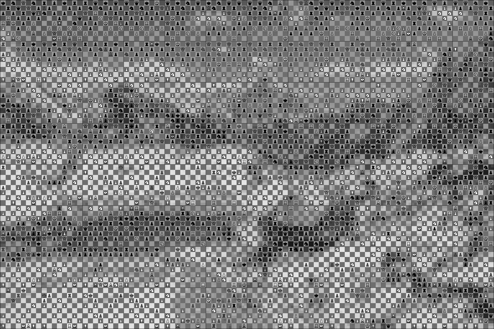
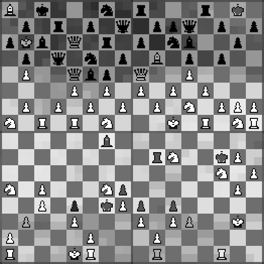

# chesser

Turns an image into a grid of chessboards. Every board is a legal chess position, either generated or taken from a real Lichess game.

## Demo





```sh
chesser convert examples/mountain.jpg --boards 12 --square-size 16 --games --threshold 0.9 -o docs/demo.png
```

## Requirements

- Python ≥ 3.10, a C compiler with OpenMP, an AVX2 CPU (libzstd optional, for `compress`)
- Rust (cargo) for the native tools (indexer, move search)
- NixOS: `nix-shell` provides all of it

## Install

```sh
pip install .
cargo install --path native   # chesser-indexer, chesser-play
```

## Usage

```sh
chesser convert photo.jpg --boards 16                 # generated positions only
chesser download --latest 1                           # fetch + index the newest Lichess month
chesser convert photo.jpg --boards 16 --games         # prefer real game positions
chesser convert a.jpg b.jpg --games -o 'out/{stem}.png'
chesser verify photo-chess.json
```

Every output image comes with a `.json` file listing each board's FEN and, for real positions, the game and a lichess.org link.

Data goes to `$CHESSER_DATA`, else `./data`, else `~/.local/share/chesser`.

## `convert`

| flag | default | |
| --- | --- | --- |
| `-o, --output` | `{stem}-chess.png` | output image |
| `--json` | output name `.json` | board listing |
| `-b, --boards` | 8 | boards across |
| `--boards-high` | auto | boards down (auto: least cropping) |
| `--square-size` | 8 | pixels per square |
| `--theme` | mono | `mono`, `classic`, `wood` |
| `--shades` | 12 | square shade levels |
| `--light-band` | 150,235 | light square brightness range |
| `--dark-band` | 25,110 | dark square brightness range |
| `--piece-shades` | 5 | piece shade levels |
| `--white-band` | 170,255 | white piece brightness range |
| `--black-band` | 0,85 | black piece brightness range |
| `--spread` | 10 | max shade shift of a square's quadrants |
| `--smooth` | 0.5 | pull of square shades toward the smoothed image |
| `--smooth-radius` | 1.5 | smoothing radius, in squares |
| `--min-contrast` | 30 | min piece vs. square brightness difference |
| `--generate` | free | `free`, or `played` (reached by a real move sequence) |
| `--beam` | 256 | played: lines kept per half-move |
| `--max-plies` | 120 | played: max game length |
| `--min-plies` | 20 | played: min game length |
| `--plausibility` | 2 | played: 0 legal, 1 no mate in one available, 2 no piece won outright |
| `--max-promotions` | 1 | extra pieces per side beyond a normal army |
| `--iters` | 4000 | search steps per board |
| `--games [DIR]` | off | use real game positions |
| `--threshold` | 0.9 | min fit for a real position (1.0 = as good as generated) |
| `--game-min-pieces` | 16 | ignore sparser real positions |
| `--candidates` | 32 | candidates per board and shard |
| `--fit-floor` | 4.0 | error floor in the fit ratio |
| `--grid` | 2 | board separator width (0 = none) |
| `--grid-color` | 20,20,20 | separator colour |
| `--grid-opacity` | 0.45 | separator opacity |
| `--scale` | 1 | output upscale |
| `--seed` | 0 | random seed |
| `--workers` | all cores | worker processes |

## `download`

| flag | default | |
| --- | --- | --- |
| `MONTHS` | | months as `YYYY-MM` |
| `--list` | | published months and sizes |
| `--range` | | `FROM:TO` |
| `--latest` | | newest N months |
| `--budget` | | newest months fitting in N GB |
| `--stride` | 4 | keep every Nth position per game |
| `--min-ply` | 8 | skip the first N plies |
| `--threads` | auto | indexer threads |
| `--delete-pgn` | off | delete downloads once indexed |
| `--no-index` | off | download only |
| `--no-verify` | off | skip SHA-256 check |
| `--reindex` | off | rebuild existing shards |
| `--force` | off | ignore the free-space check |

## `index`

| flag | default | |
| --- | --- | --- |
| `PGN...` | | `.pgn` or `.pgn.zst` files |
| `-o, --output` | `<data>/index` | shard directory |
| `--min-ply` | 8 | skip the first N plies |
| `--stride` | 4 | keep every Nth position per game |
| `--threads` | auto | indexer threads |

## `compress`

Lossless zstd of index blocks (3.5× smaller, identical results, needs libzstd). Small searches get ~2× faster; large ones are compute-bound and not.

| flag | default | |
| --- | --- | --- |
| `SHARDS` | `<data>/index` | a shard or a directory of shards |
| `--level` | 9 | zstd level |

## `verify`

| argument | |
| --- | --- |
| `JSON` | output listing to re-check |

## Sizes

Measured on Lichess January 2022 (`--stride 4`, `--min-ply 8`):

| | |
| --- | --- |
| download | 33.2 GB |
| games | 102.1M read, 99.3M kept |
| positions | 1.34B |
| index | 66 GB |
| indexing time | 11.6 min (16 threads) |
| search, 176 boards | ~75 s |

## License

AGPL-3.0-or-later. Pieces: cburnett set by Colin M.L. Burnett via Lichess, [GPLv2+](https://www.gnu.org/licenses/gpl-2.0.txt). Example photo: Vyacheslav Argenberg, [CC BY 4.0](https://creativecommons.org/licenses/by/4.0).
